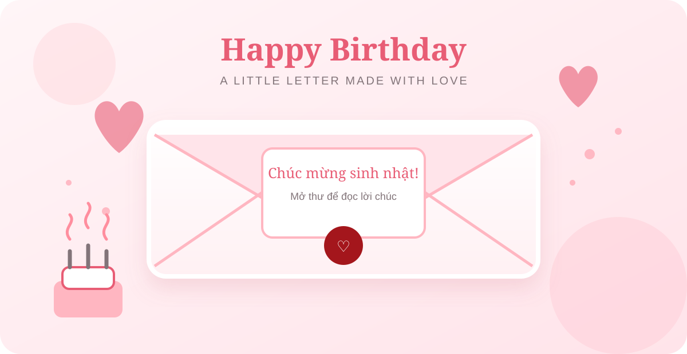

# Birthdayth

> **VI:** Thiệp sinh nhật tương tác được xây dựng bằng Svelte, với phong cách pastel nhẹ nhàng, hiệu ứng mở thư, nhạc nền và lời chúc cá nhân hóa.  
> **EN:** A sweet interactive birthday letter built with Svelte, featuring a soft pastel design, letter-opening animation, background music, and personalized wishes.



## Tính năng | Features

### Tiếng Việt

- Giao diện thiệp sinh nhật.
- Hiệu ứng mở phong thư và hiển thị lời chúc dạng typewriter.
- Đồng hồ đếm ngược đến ngày sinh nhật.
- Nhạc nền và nhạc riêng khi mở thư.
- Hiệu ứng cánh hoa, pháo giấy và âm thanh tương tác.
- Gửi điều ước qua Telegram Bot nếu được cấu hình.
- Lưu lời chúc thành ảnh PNG.

### English

- Birthday card interface.
- Interactive envelope-opening animation with a typewriter-style wish.
- Countdown timer to the birthday.
- Background music and dedicated letter music.
- Floating petals, confetti, and interactive sound effects.
- Optional wish delivery through a Telegram Bot.
- Save the birthday letter as a PNG image.

## Công nghệ | Tech stack

- [Svelte](https://svelte.dev/)
- [Vite](https://vite.dev/)
- [Tailwind CSS](https://tailwindcss.com/)
- [canvas-confetti](https://www.npmjs.com/package/canvas-confetti)
- [html2canvas](https://html2canvas.hertzen.com/)

## Bắt đầu | Getting started

### Yêu cầu | Requirements

- Node.js 18 trở lên | Node.js 18 or later
- npm

### Cài đặt và chạy local | Install and run locally

```bash
npm install
npm run dev
```

Mở địa chỉ được hiển thị trong terminal, thường là `http://localhost:5173`.

Open the URL shown in the terminal, usually `http://localhost:5173`.

### Build production

```bash
npm run build
npm run preview
```

## Tùy chỉnh | Customization

### Tiếng Việt

Mở file [`src/birthday.config.js`](src/birthday.config.js) để thay đổi:

- Tên và nickname người nhận.
- Ngày sinh nhật và ngày hiển thị.
- Tên và đường dẫn các file nhạc.
- Nội dung lời chúc và chữ ký.
- Thông tin Telegram Bot nếu muốn nhận điều ước.

Đặt các file nhạc vào thư mục `public/music/`:

```text
public/music/bg.mp3
public/music/letter.mp3
```

### English

Open [`src/birthday.config.js`](src/birthday.config.js) to customize:

- Recipient name and nickname.
- Birthday and display date.
- Music titles and file paths.
- Birthday wishes and signature.
- Telegram Bot settings for receiving wishes.

Place the music files in `public/music/`:

```text
public/music/bg.mp3
public/music/letter.mp3
```

## Cấu trúc chính | Main structure

```text
src/
├── App.svelte
├── birthday.config.js
├── app.css
└── lib/
    ├── sound.js
    └── components/
        ├── CountdownWidget.svelte
        ├── FloatingPetals.svelte
        ├── InteractiveSection.svelte
        ├── IntroSection.svelte
        ├── MainWishSection.svelte
        └── MusicPlayer.svelte
```
## License

**VI:** Project cá nhân dùng cho mục đích học tập và tạo thiệp tặng người thân, bạn bè.  
**EN:** A personal project for learning and creating birthday cards for family and friends.
